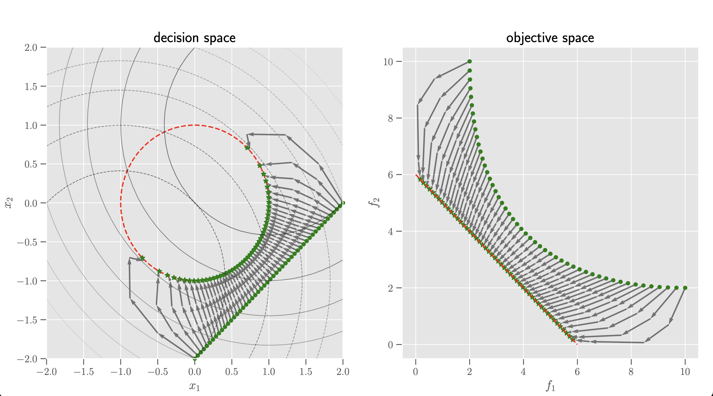
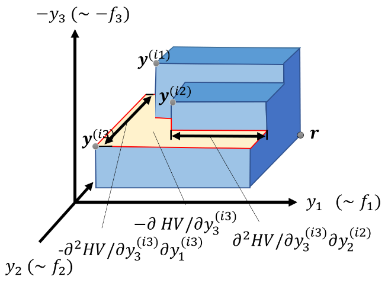

# Hypervolume Indicator Derivatives

* **What for?**
  * a **Hypervolume Newton Method** for solving _continuous multiobjective optimization problems_ (MOPs),
  * enabled by the analytically computation of **Hypervolume Hessian Matrix**.
* **Why?**
  * the Newton method has a local **quadratic convergence** under some mild condition of objective functions.
  * Perhaps, you'd like to refine the final outcome of some direct optimizers with the Hypervolume Newton method..
* **When to use it?** the objective function is at least *twice continuously differentiable*.



Specifically, you will find the following major functionalities:

1. `hvd.HypervolumeDerivatives`: the analytical computation of the HV Hessian and specifically, Alg. 2 described in [[DEW22]](https://arxiv.org/abs/2211.04171).
2. `hvd.HVN`: Hypervolume Newton Method for (Constrained) Multi-objective Optimization Problems in [[WED+22]](https://www.preprints.org/manuscript/202211.0103/v1).

## Installation

<!-- You could either install the stable version on `pypi`: -->
A `pypi` package will be available soon:
<!-- ```shell
pip install hvd
``` -->

For now, please take the lastest version from the master branch:

```shell
git clone https://github.com/wangronin/HypervolumeDerivatives.git
cd HypervolumeDerivatives && python setup.py install --user
```

## Hypervolume Hessian Matrix

Hypervolume (HV) Indicator of a point set $Y\subset\mathbb{R}^m$ computes the Lebesgue measure of the subset of $\mathbb{R}^m$ that is dominated by $Y$. HV is **Pareto compliant** and often used as a quality indicator in Evolutionary Multi-objective Optimization Algorithms (EMOAs), e.g., SMS-EMOA. Since maximizing HV w.r.t. the point set $S$ will lead to finite approximations to the (local) Pareto front, HV can also be used to guide the multi-objective search.

Consider an objective function $F:\mathbb{R}^d \rightarrow \mathbb{R}^m$, subject to minimization and a point set $X\subset \mathbb{R}^d$ of cardinality $n$. We care about the fast, analytical computation of the following quantity:
$$\frac{\partial^2 HV(F(X))}{\partial X \partial X^\top},$$
which is a $nd \times nd$-matrix. The implementation works for multi- and many-objective cases.

### Example

```Python
import numpy as np
from hvd import HypervolumeDerivatives
from hvd.newton import HVN

# Compute the HV Hessian w.r.t. the objective points
ref = np.array([9, 10, 12])
hvh = HypervolumeDerivatives(3, 3, ref, minimization=True)
out = hvh.compute_derivatives(X=np.array([[5, 3, 7], [2, 1, 10]]), compute_hessian=True)

# Define constants for the objective space
c1 = np.array([1.5, 0, np.sqrt(3) / 3])
c2 = np.array([1.5, 0.5, -np.sqrt(3) / 6])
c3 = np.array([1.5, -0.5, -np.sqrt(3) / 6])
ref = np.array([24, 24, 24])

# Accept either one point or a population in the objective and its derivatives.
def MOP1(x):
    x = np.array(x)
    return np.stack(
        [
            np.sum((x - c1) ** 2, axis=-1),
            np.sum((x - c2) ** 2, axis=-1),
            np.sum((x - c3) ** 2, axis=-1),
        ],
        axis=-1,
    )

def MOP1_Jacobian(x):
    x = np.array(x)
    return np.stack(
        [
            2 * (x - c1),
            2 * (x - c2),
            2 * (x - c3),
        ],
        axis=-2,
    )

def MOP1_Hessian(x):
    return np.broadcast_to(2 * np.eye(3), (*np.shape(x)[:-1], 3, 3, 3))

# Compute the HV Hessian w.r.t. the decision points
hvh = HypervolumeDerivatives(
    n_var=3, n_obj=3, ref=ref, func=MOP1, jac=MOP1_Jacobian, hessian=MOP1_Hessian
)

w = np.random.rand(20, 3)
w /= np.sum(w, axis=1).reshape(-1, 1)
X = w @ np.vstack([c1, c2, c3])
out = hvh.compute(X)

# Hypervolume Newton Method
max_iters = 10
mu = 20
ref = np.array([20, 20, 20])
w = np.abs(np.random.rand(mu, 3))
w /= np.sum(w, axis=1).reshape(-1, 1)
x0 = w @ np.vstack([c1, c2, c3])

opt = HVN(
    n_var=3,
    n_obj=3,
    ref=ref,
    func=MOP1,
    jac=MOP1_Jacobian,
    hessian=MOP1_Hessian,
    X0=x0,
    xl=np.full(3, -2),
    xu=np.full(3, 2),
    max_iters=max_iters,
    verbose=True,
)

X, Y, stop = opt.run()
```

## MMD kernels

The `hvd.mmd` package contains the vectorized indicators, kernels, and legacy
implementation. The Newton optimizer remains in `hvd.mmd_newton`.
Pass a configured kernel to `MMD` or `MMDMatching`:

```python
from hvd.mmd import MMD
from hvd.mmd.kernels import RBF, RationalQuadratic

kernel = RationalQuadratic(theta=0.7, alpha=1.3)
indicator = MMD(n_var=3, n_obj=3, ref=reference_set, kernel=kernel)
```

Kernel parameters belong to the kernel. Replace `MMD(..., theta=t)` with
`MMD(..., kernel=RBF(theta=t))`. `Laplace`
is also available in `hvd.mmd.kernels`. The existing `theta`
formulas are unchanged, so saved tuning configurations remain valid.
Kernels are immutable; create a new instance when changing parameters.
Each kernel owns its cached, JIT-compiled `gradient`, `hessian`, and
`mixed_hessian`, computed with `jacrev` and `jacfwd`. It also exposes
`diagonal`, `diagonal_gradient`, and `diagonal_hessian` for the function
`k(x, x)`. Population helpers provide all-pairs evaluation (`pairwise*`),
evaluation of already aligned pairs (`matched*`), and self-pair evaluation
(`diagonal*_batch`). Their docstrings specify pairing rules and output shapes.
MMD combines these kernel evaluations into indicator values and derivatives.
Subclasses can override the derivative functions with analytical formulas.
Custom JAX-compatible callables accepting `(x, y)` are supported through
the `CallableKernel` adapter, applied automatically by MMD.

Create the indicator before passing it to `MMDN`. The indicator owns its
reference set, objective callbacks, kernel, and any matching parameters:

```python
from hvd.mmd import MMDMatching
from hvd.mmd.kernels import RationalQuadratic
from hvd.mmd_newton import MMDN

indicator = MMDMatching(
    n_var=problem.n_var,
    n_obj=problem.n_obj,
    ref=reference_set,
    func=problem.objective,
    jac=problem.objective_jacobian,
    hessian=problem.objective_hessian,
    kernel=RationalQuadratic(theta=0.7, alpha=1.3),
    beta=0.25,
)
optimizer = MMDN(
    n_var=problem.n_var,
    n_obj=problem.n_obj,
    func=problem.objective,
    jac=problem.objective_jacobian,
    xl=problem.xl,
    xu=problem.xu,
    indicator=indicator,
)
```

The `indicator` argument is required. Use `MMD` instead of `MMDMatching` above
for ordinary MMD. `MMDN` does not create an indicator or accept `ref`,
`matching`, `beta`, `kernel`, or an objective `hessian`; configure these on
the indicator. Access or replace the reference through `indicator.ref`.
`MMDN` evaluates the indicator and decides when to request a reference shift:
initially, then when a point is near a reference target and its previous
Newton step is near zero. It calls `indicator.shift_reference_set(indices=...)`
for the selected points. Both indicators forward the shift to `ReferenceSet.shift`,
which controls how reference points or matched medoids move. The indicator
records target trajectories in `history_reference_set`.
During line searches, the optimizer uses the indicator's `trial_evaluation()`
context. `MMDMatching` keeps its matching fixed and always enables `re_match`
on exit, including when evaluation raises an exception; ordinary `MMD` needs
no temporary state change.

Native problem methods accept either a point `(n_var,)` or a population
`(N, n_var)`: use `problem.objective(X)` or `problem.eq_constraint(X)` for
either input shape. The same applies to Jacobians and Hessians. Population
results have a leading axis of size `N`; derivatives are computed per point.
These methods replace the separate public `*_batch` methods while retaining
cached `jit(vmap(...))` implementations. Constraint methods return `None` when
their constraint count is zero.
Custom callbacks passed to optimizers must follow the same point-or-population
convention: `State` passes the input directly to the callback.

## MMD tuning

The tools in `scripts/tune_MMD/` follow an explicit workflow:
**tune → inspect candidate plots → select → benchmark → report**.
There is no online controller or auditing stage. See
[scripts/tune_MMD/README.md](scripts/tune_MMD/README.md) for commands and outputs.

```shell
python scripts/tune_MMD/tune_MMD.py WFG2 --algorithm NSGA-II --workers 15 --output-dir mmd_tuning_results/new-study
python scripts/tune_MMD/review_MMD.py review mmd_tuning_results/new-study WFG2 --algorithm NSGA-II
```

Defaults are generation 600, five Newton steps, 100 cumulative attempts,
training runs 1–20 and held-out runs 21–30. Choose a configuration using its
training score and visual inspection before benchmarking all available runs.
The Slurm launcher accepts `WFG` (WFG2–9) or `IDTLZ` (IDTLZ1–4).

Prepared populations/reference sets are stored in `data/`; examples and fixtures
are in `test_data/`. Problem classes are resolved by name from `hvd.problems`,
and dimensions come from the stored populations.

`scripts/tune_MMD/tune_MMD.py` and `scripts/tune_MMD/review_MMD.py` support IDTLZ1–IDTLZ4,
WFG1–WFG9, Eq1DTLZ1–Eq1DTLZ4, and Eq1IDTLZ1–Eq1IDTLZ4 with MOEA/D
(`MOEAD` on the command line), NSGA-II, and NSGA-III. Both pass equality
constraints and their first and second derivatives to Newton, along with
the box inequalities. Class-name and uppercase dataset prefixes are supported
(for example, `Eq1DTLZ1` on the command line and `EQ1DTLZ1` in CSV filenames).
Eq1 hypervolume reference points are `(2, 2, 2)`, matching their parent families.
Eq1 scoring uses the intersection of the parent Pareto set and `h(x) = 0`.
The distance variables stay at `0.5`, and the position variables lie on the
two spheres with squared radii `0.4**2 - 1e-4` and `0.4**2 + 1e-4`, as required
by the implemented equality constraint. Sampling is deterministic across
tuning workers; in three objectives, it uses evenly spaced angles on both circles.

The copied Eq1 datasets need a separate preprocessing correction before their
scores can be trusted: for example, NSGA-III run 1 of Eq1DTLZ2 stores
`[f2, f3, h1]` in `lastpopu_y` instead of `[f1, f2, f3]`. Population and
reference-set exports must select objective columns explicitly, excluding
constraints. The scripts do not silently replace these stored values.

The WFG hypervolume reference points in `scripts/ref_point.csv` are
`(3, 5, 7)`, following the convention `r_i = 2i + 1` in Section IV-C of
[Li, Özcan, and John, *A Learning Automata based Multiobjective Hyper-heuristic*](https://nottingham-repository.worktribe.com/OutputFile/901013).
This point also exceeds every stored WFG objective value. It is used for
hypervolume evaluation; the tuning objective remains averaged Hausdorff distance.

## Scientific benchmarks

`scripts/benchmark_DpN.py` and `scripts/benchmark_MMD.py` resolve problem classes
by name from `hvd.problems`, using `getattr(problems, problem_name)`. Both read
`n_var` and `n_obj` from the stored population files. Defaults are NSGA-III,
`data/`, generation 600 and five Newton iterations.

```shell
python scripts/benchmark_DpN.py IDTLZ1 --n-jobs 15 --type deltap --regularization --project-box-constraints --skip-plots --skip-populations
python scripts/benchmark_MMD.py WFG2 --algorithm NSGA-II --config-file mmd_tuning_results/MMDNewton-MMDMatching-WFG2-NSGA-II-bounds-best.json --n-jobs 15
```

DpN processes every discovered instance. Its optional `--regularization` and
`--project-box-constraints` flags control the solver settings. It writes a CSV
with run ID, HV, IGD, GD and Jacobian calls; plots and population exports can be
skipped with the flags above. On ALICE, the shell launchers accept `WFG` (WFG2–9,
the default) or `IDTLZ` (IDTLZ1–4). Create the log folder before submitting:

```shell
mkdir -p results/logs
sbatch scripts/benchmark_DpN.sh WFG
sbatch scripts/benchmark_MMD.sh WFG
# For IDTLZ, use --array=0-11%12 with either launcher:
sbatch --array=0-11%12 scripts/benchmark_MMD.sh IDTLZ
```

The MMD launcher loads each pair's frozen `MMDNewton-MMDMatching-...-bounds-best.json`
configuration from `mmd_tuning_results/`.

The standalone MMD benchmark reads one configuration, executes instances 1–30
and writes one CSV with run ID, HV, IGD, GD and Jacobian calls.
It uses regularization and box projection from the saved configuration;
`--regularization` / `--no-regularization` and `--project-box-constraints` /
`--no-project-box-constraints` override those settings explicitly. `--output`
sets an exact filename; otherwise `--results-dir` uses the existing
`PROBLEM-MMDNMatching-ALGORITHM-GENERATION.csv` convention (or `MMDN` without matching).
Visual candidate review and selection are handled separately under `scripts/tune_MMD/`.

AHD is `max(GD, IGD)`. The statistics script compares all 30 paired runs across
IDTLZ1–4 and WFG2–9, including the stored initial MOEA baseline.

### Gradient and bootstrap benchmarks

`benchmark_MGDA.py` uses the `MGDA` method/file tag and implements
[multiple-gradient descent (MGDA)](https://mgda.inria.fr/mgda): the negative
minimum-norm convex combination of objective gradients, with box bounds and an
Armijo line search for all objectives. It supports more than three objectives;
intrinsic equality/inequality constraints are not handled by this method.

`benchmark_MMD_bootstrap.py` accepts the same configuration files and solver
options as `benchmark_MMD.py`. It uses the existing population-based reference
refresh, without the removed RSG module. Defaults are nine Newton steps, refresh
interval three, and resampling from the last three completed populations. The
final Newton iteration is included in that resampling. Its output method tag is
`MMDNBootstrap` or `MMDNMatchingBootstrap`, according to the configuration.

```shell
python scripts/benchmark_MGDA.py IDTLZ1 --algorithm NSGA-II --n-jobs 15
python scripts/benchmark_MMD_bootstrap.py WFG2 --algorithm NSGA-II --config-file mmd_tuning_results/MMDNewton-MMDMatching-WFG2-NSGA-II-bounds-best.json --n-jobs 15
```

Both write one CSV with `run,HV,IGD,GD,Jac_calls` under `results/`, using the same
problem/method/algorithm/generation convention. For a different number of
objectives, supply `--ref-point` with one value per objective; stored populations
determine the problem dimensions.

### Fresh MOEA runs and population export

`benchmark_MOEA.py` is the shared runner for both budgets. Each run starts with a
fresh MOEA population, seeded by its run ID:

```shell
# Match each Newton run's budget: ceil(3.215 * that run's Jac_calls).
python scripts/benchmark_MOEA.py IDTLZ1 --algorithm NSGA-II --budget newton --newton MMDNMatching --n-jobs 15
# Fixed generations, with the final seven populations exported.
python scripts/benchmark_MOEA.py WFG2 --algorithm MOEAD --budget fixed --generation 600 --save-populations --n-jobs 15
```

`--generation` selects the source Newton CSV in `newton` mode and the generation
budget in `fixed` mode. Newton budgets use the matching run ID, with no median
aggregation or added initialization budget. Pymoo stops at offspring-batch
boundaries, so actual function evaluations can exceed the converted target.
Population size defaults to 100/300/600
for 2/3/4 objectives, and reference directions match the objective count.
Use `--n-var`, `--n-obj`, `--pop-size`, and `--ref-point` to override dimensions,
population size and the hypervolume reference point.

Both budgets use `results/PROBLEM-ALGORITHM-GENERATION.csv`, with
`run,HV,IGD,GD`. Use `--output` to retain separate files for different budgets
or to preserve an existing initial MOEA baseline. Runs
without a feasible solution retain their run ID and unavailable (`NaN`) metrics.
`--output` selects an exact filename.

`--save-populations` writes `PROBLEM_ALGORITHM.csv` and `.mat` in
`--population-dir` (default `data/`). Columns identify `run`, `iteration`,
decisions (`x*`), objectives (`f*`), and constraints (`h*`, `g*`) separately.
`--last-generations` controls how many final populations to retain; CSV exports
preserve 17 significant digits.

```shell
mkdir -p results/logs
sbatch scripts/run_EA_save_population.sh
```

The launcher covers the original 21 problems (WFG1–9, IDTLZ1–4, Eq1IDTLZ1–4,
Eq1DTLZ1–4) across NSGA-II, NSGA-III and MOEAD: 63 tasks, at most 20 concurrent.
Each task runs 30 seeds using its 15 allocated CPUs. Extra command-line arguments
are forwarded to the shared runner. Numerical runs on ALICE use Slurm allocations.

## Brief Explanation of the Analytical Computation

The **hypervolume indicator** (HV) of a set of points is the m-dimensional Lebesgue measure of the space that is jointly dominated by a set of objective function vectors in $\mathbb{R}^m$ and bound from above by a reference point. HV is widely investigated in solving _multi-objective optimization problems_ (MOPs), where it is often used as a performance indicator for assessing the quality of _Evolutionay Multi-objective Optimization Algorithms_ (EMOAs), or employed to solve MOPs directly, e.g., [Hypervolume Indicator Gradient Algorithm](https://scholar.google.com/citations?view_op=view_citation&hl=en&user=Pz9c6XwAAAAJ&citation_for_view=Pz9c6XwAAAAJ:5nxA0vEk-isC) and [Hypervolume Indicator Netwon Method](https://scholar.google.com/citations?view_op=view_citation&hl=en&user=Pz9c6XwAAAAJ&citation_for_view=Pz9c6XwAAAAJ:QIV2ME_5wuYC).

We show an example of 3D hypervolume indicator and the geometrical meaning of its partial derivatives as follows.



In this chart, we have three objective function to minimize, where we depicts three objective points, $y^{(i1)}, y^{(i2)}, y^{(i3)}$. The hypervolume (HV)indicator value, in this case, is the volume of the 3D ortho-convex polygon (in blue) - the subset dominated by $y^{(i1)}, y^{(i2)}, y^{(i3)}$. The first-order partial derivative of HV, for instance, $\partial HV/\partial y_3^{(i3)}$ is the yellow-colored 2D facet. The second-order partial derivative of HV, e.g., $\partial^2 HV/\partial y_3^{(i3)} \partial y_2^{(i2)}$ is an edge of the polygon.

## Symbolic computation of the Hessian in Mathematica

Also, we include, in folder `mathematica/`, several cases of the hypervolume indicator Hessian computed symoblically using `Mathematica`.

## References

* [[WED+22]](https://www.preprints.org/manuscript/202211.0103/v1) Wang, H.; Emmerich, Michael T. M.; Deutz, A.; Hernández, V.A.S.; Schütze, O. The Hypervolume Newton Method for Constrained Multi-objective Optimization Problems. _Preprints_ **2022**, 2022110103.

* [[DEW22]](https://arxiv.org/abs/2211.04171) Deutz, A.; Emmerich, Michael T. M.; Wang, H. The Hypervolume Indicator Hessian Matrix: Analytical Expression, Computational Time Complexity, and Sparsity, _arXiv_, 2022.

## WFG fronts and limitations

Efficient decisions are nondominated over all feasible decisions; their objective
image is the Pareto front ([Huband et al., 2006, Section III-A](https://doi.org/10.1109/TEVC.2005.861417)).
`get_pareto_set(N)` constructs inverse representatives from the published WFG
transformations. WFG2 restricts samples to efficient disconnected branches;
WFG3 includes the line and sheet in [Ishibuchi et al., 2016, Eq. (25)](https://doi.org/10.1109/TEVC.2015.2505784).

- **WFG1:** the `0.02` power amplifies float64 roundoff, so evaluated nominal
  efficient decisions may differ substantially from the analytical front.
  Failed checks raise `FloatingPointError`; `allow_approximate=True` returns
  nominal decisions with a warning. The full Jacobian/Hessian are undefined at
  efficient decisions. Preserve 17 significant digits when exporting populations.
- **WFG3:** complete fronts/sets currently support only two or three objectives.
- **Set sampling:** returns one inverse representative per target point, not all
  inverse branches. Custom bounds may exclude the selected representatives.

View all nine fronts against theoretical meshes interactively (drag to rotate):

```shell
python scripts/plot_WFG_final_fronts.py
```

Use `--output fronts.png` to save an image, or add `--no-show` for saving only.
